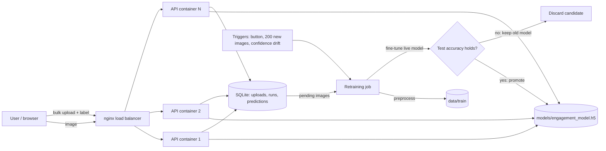
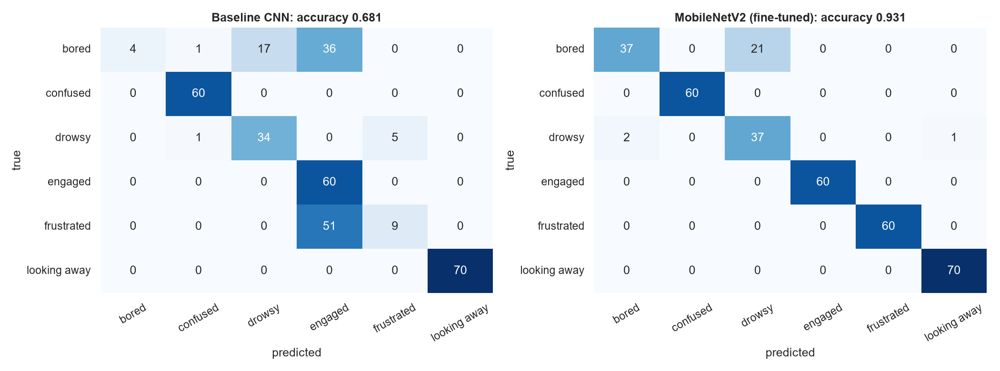
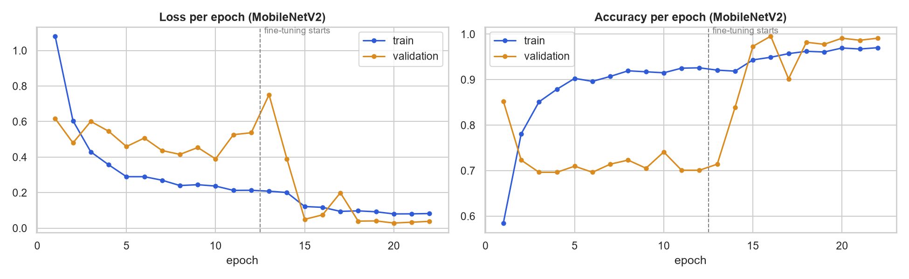

# EngageWatch: Student Engagement Detection Pipeline

An end-to-end machine learning pipeline that classifies a **webcam frame of a student in an online class** into one of six engagement states, serves the model through an API and a web dashboard, accepts bulk uploads of new labelled images, and **retrains itself** on demand or when a trigger fires.

Summative project for Machine Learning Pipeline, by Joshua Agonzibwa.

| Deliverable | Link |
|---|---|
| Video demo (YouTube) | |
| Live application | <https://engagewatch.lemonriver-1cb3c56a.francecentral.azurecontainerapps.io/>|
| Notebook | [`notebook/student_engagement.ipynb`](notebook/student_engagement.ipynb) |
| Model file | [`models/engagement_model.h5`](models/engagement_model.h5) |
| API documentation | `/docs` on the running service (Swagger UI) |

## Project description

My Introduction to Machine Learning summative predicted which students are at risk of failing or withdrawing, using tabular click-stream data (OULAD). Its main finding was that behaviour matters far more than background: how much a student engages is the strongest warning signal.

This project carries the same use case into image data. Instead of counting clicks after the fact, it reads engagement directly from the student's webcam during a lesson.

| Group | Classes |
|---|---|
| Engaged | `engaged`, `confused`, `frustrated` |
| Not engaged | `bored`, `drowsy`, `looking_away` |

A confused or frustrated student is still attending to the lesson, so those states count as engaged. The model predicts the six-way class and the API also reports the two-way group and the probability that the student is engaged.

**Dataset.** [Student-engagement](https://www.kaggle.com/datasets/joyee19/studentengagement) by Joyeeta Dey on Kaggle: 2,120 frames captured by laptop webcams during online classes.

### What the system does

| Requirement | Where it lives |
|---|---|
| Data acquisition | `src/preprocessing.py` (`acquire`, `download_dataset`, `build_splits`) |
| Data processing | `src/preprocessing.py` (validate, EXIF, RGB, square crop, resize, splits, `tf.data`) |
| Model creation | `src/model.py` (MobileNetV2 transfer learning, two-phase fine-tuning) |
| Model testing | `src/model.py` (`evaluate_model`), notebook section 8, `POST /evaluate` |
| Model retraining and triggers | `src/retrain.py`, `POST /retrain`, automatic volume and drift triggers |
| API | `api/main.py` (FastAPI) |
| UI: up-time, visualisations, train and retrain | `api/static/` (served at `/`) |
| Database for uploaded data | `src/database.py` (SQLite: uploads, training runs, prediction log) |
| Containers and scaling | `Dockerfile`, `docker-compose.yml`, `nginx.conf` |
| Flood simulation | `load_tests/locustfile.py`, `scripts/run_load_test.py` |

### Architecture



## Repository structure

```
.
├── README.md
├── requirements.txt              Full environment (notebook, training, API, Locust)
├── requirements-serve.txt        Slim environment used inside the container
├── Dockerfile                    API + UI + retraining in one image
├── docker-compose.yml            N API containers behind nginx
├── nginx.conf                    Round-robin load balancer
├── render.yaml                   Render blueprint
├── notebook/
│   └── student_engagement.ipynb  Preprocessing, training, tuning, evaluation, prediction, retraining
├── src/
│   ├── config.py                 Paths, class names, hyperparameters, trigger thresholds
│   ├── preprocessing.py          Acquisition and preprocessing
│   ├── model.py                  Model creation, training, evaluation, saving, fine-tuning
│   ├── prediction.py             Single-image prediction and the in-memory model service
│   ├── retrain.py                Retraining pipeline and triggers
│   ├── database.py               SQLite persistence
│   └── insights.py               Feature statistics behind the visualisations
├── api/
│   ├── main.py                   FastAPI endpoints
│   └── static/                   Dashboard (HTML, CSS, JavaScript)
├── data/
│   ├── train/<class>/            1,602 images (validation is split off in code)
│   ├── test/<class>/             348 held-out images
│   ├── retrain_pool/<class>/     170 held-back images for the retraining demo
│   ├── insights.json             Precomputed statistics for the dashboard
│   └── mean_images/              Average frame per class
├── models/
│   ├── engagement_model.h5       Trained Keras model
│   └── model_metadata.json       Version, training date, class order, test metrics
├── load_tests/
│   ├── locustfile.py             Locust user behaviour
│   └── results/                  CSV and HTML reports, summary tables
├── scripts/
│   └── run_load_test.py          Runs Locust at several container counts
├── deploy/huggingface/           Files for a Hugging Face Space
└── docs/figures/                 Figures used in this README
```

## Model and results

**Model.** MobileNetV2 pretrained on ImageNet, followed by global average pooling, dropout, a dense layer with L2 regularisation, dropout and a 6-way softmax. Augmentation and input scaling are layers inside the model, so serving code only has to resize.

**Optimisation techniques.** Pretrained backbone; dropout, L2 and data augmentation; Adam with `ReduceLROnPlateau`; early stopping with best-weight restore; inverse-frequency class weights; a random search over dropout, L2, head width and learning rate; two-phase fine-tuning (head first, then the top 30 backbone layers at a low learning rate).

**Held-out test set (348 images).**

| Metric | Baseline CNN (from scratch) | MobileNetV2 (fine-tuned) |
|---|---:|---:|
| Accuracy | 0.681 | **0.931** |
| Loss (cross-entropy) | 0.699 | **0.222** |
| Precision (macro) | 0.781 | **0.929** |
| Recall (macro) | 0.678 | **0.927** |
| F1 (macro) | 0.614 | **0.919** |
| ROC-AUC (one-vs-rest) | 0.961 | **0.990** |
| Engaged vs not engaged accuracy | | **1.000** |

All 24 test errors stay inside the not-engaged group, and 21 of them are `bored` frames predicted as `drowsy` (the same student in the same room appears in both classes). `confused`, `engaged`, `frustrated` and `looking_away` have recall 1.00. One prediction takes about 35 ms on CPU.




### How to read these numbers

The dataset contains only a few students, each recorded in their own room, and several classes come mostly from one recording session. The test set holds out blocks of consecutive frames, so it measures accuracy on **unseen frames from the same recording sessions**, not on unseen students. Section 3 of the notebook shows that simple image statistics such as contrast already separate some classes, which means part of this score comes from recognising the room. Performance on a new student, camera or background will be lower until the model is retrained with such data. That is the reason this system has an upload-and-retrain loop, and it is the first thing I would test with more data.

## Setting it up

Requirements: Python 3.10 to 3.13. Docker is optional.

### 1. Run locally

```bash
git clone https://github.com/jagonzibwa/Joshua-Agonzibwa-Summative-assignment---MLOP.git
cd Joshua-Agonzibwa-Summative-assignment---MLOP

python -m venv .venv
# Windows:   .venv\Scripts\activate
# macOS/Linux: source .venv/bin/activate
pip install -r requirements.txt

uvicorn api.main:app --host 0.0.0.0 --port 8000
```

Open <http://localhost:8000> for the dashboard and <http://localhost:8000/docs> for the API documentation.

The trained model and the data are in the repository, so nothing else is needed. To rebuild everything from scratch:

```bash
python -m src.preprocessing --acquire     # download the dataset, build data/train, data/test, data/retrain_pool
python -m src.insights                    # recompute the statistics behind the visualisations
python -m src.model                       # train and save models/engagement_model.h5
```

Useful commands:

```bash
python -m src.prediction data/test/engaged/engaged_0143.jpg   # classify one image
python -m src.retrain                                       # retrain on images waiting in the database
jupyter notebook notebook/student_engagement.ipynb          # open the notebook
```

### 2. Run with Docker

```bash
docker build -t engagewatch .
docker run -p 8000:8000 engagewatch
```

### 3. Run several containers behind a load balancer

```bash
docker compose up -d --build --scale api=4
```

Open <http://localhost:8080>. nginx spreads requests across the API containers. Each container is limited to one CPU and they share the data and model volumes, so a model promoted by a retraining run in one container is picked up by the others.

```bash
docker compose down        # stop (add -v to also delete uploads and retrained models)
```

## Using the application

| Page | What it shows |
|---|---|
| **Overview** | Model up-time, live status, availability, health-check response time, request counts, prediction latency, memory and CPU, live model version and its test metrics |
| **Predict** | Upload one image (or click a held-out test image whose true label is known) and get the class, confidence, engaged / not-engaged group and all six probabilities. You can record the correct label as feedback |
| **Data insights** | Class balance, the average frame per class, and five interpretable image features with a written interpretation of each |
| **Upload & retrain** | Bulk upload of labelled images (many files or a .zip) into the database, the retraining button with live progress and a before/after metrics table, the automatic trigger status, and the history of runs |
| **Evaluation** | Runs the live model on the test set inside the running service: accuracy, loss, precision, recall, F1, ROC-AUC, confusion matrix, per-class scores. Also shows confidence over time, the mix of predicted classes and accuracy on user feedback |

### Predicting one image

1. Open **Predict**.
2. Choose an image, or click one of the test thumbnails. The thumbnails come from `data/test`, which the model never trained on, and their true label is shown.
3. Press **Predict**. For a test thumbnail the page states whether the prediction matches the true label.

Eleven of the twelve thumbnails are classified correctly. The first `drowsy` thumbnail is one of the frames the model gets wrong (it predicts `bored`), which is a convenient way to show the feedback control.

### Uploading data and retraining

1. Open **Upload & retrain**.
2. Pick the class, select many images and press **Upload to database**. `data/retrain_pool/` holds 170 images that were held back from training and testing for exactly this purpose: upload the contents of `data/retrain_pool/bored` as `bored`, and so on. A .zip of the whole `retrain_pool` folder also works, because sub-folder names are used as labels.
3. The **Upload database** table shows how many images are waiting per class.
4. Press **Start retraining**. The progress bar and log show each stage.
5. When it finishes, the page shows test metrics before and after, and whether the new model was promoted. The model version on the Overview page goes up.

What a retraining run does:

1. **Reads the uploaded images from the database** (`uploaded_images` table, status `pending`).
2. **Preprocesses them**: validation, EXIF rotation, RGB conversion, square crop, resize to 160 x 160, JPEG re-encode into `data/train/<class>/`.
3. Evaluates the live model on `data/test`.
4. **Fine-tunes the live model.** The saved model is loaded and training continues from its weights, so the custom model acts as the pretrained model. New images are mixed with a replay sample of older training images so earlier knowledge is not forgotten.
5. Evaluates the candidate on the same test set.
6. Promotes the candidate only if test accuracy has not dropped by more than 2 points. Otherwise the live model stays. The previous model file is archived either way.

### Retraining triggers

| Trigger | Condition | Setting |
|---|---|---|
| Manual | **Start retraining** button, `POST /retrain`, or `python -m src.retrain` | |
| Volume | 200 new images are waiting in the database. Checked after every upload | `AUTO_RETRAIN_MIN_NEW` |
| Drift | Mean confidence of the last 50 predictions falls below 60% and at least 10 new labelled images are available to learn from | `DRIFT_WINDOW`, `DRIFT_CONFIDENCE_FLOOR` |

Set `AUTO_RETRAIN_ENABLED=false` to keep only the manual trigger.

### API endpoints

| Method | Path | Purpose |
|---|---|---|
| GET | `/health` | Liveness probe with up-time |
| GET | `/status` | Up-time, model version and metrics, latency, memory, CPU |
| POST | `/predict` | Classify one image (`file`) |
| POST | `/feedback` | Record the true label of a past prediction |
| POST | `/upload` | Bulk upload (`label`, `files[]`), saved to the database |
| GET | `/uploads` | Contents of the upload database |
| POST | `/retrain` | Trigger retraining (`{"epochs": 3, "force": false}`) |
| GET | `/retrain/status` | Progress, log, result and trigger conditions |
| GET | `/retrain/history` | Past training runs |
| POST | `/evaluate` | Evaluate the live model on the test set |
| GET | `/monitoring` | Prediction log statistics |
| GET | `/insights` | Feature statistics for the visualisations |

```bash
curl -X POST http://localhost:8000/predict -F "file=@data/test/engaged/engaged_0143.jpg"
```

## Deploying to the cloud

The service uses about 490 MB of memory to serve this model and about 1.5 GB during a retraining run (measured locally), which rules out 512 MB free tiers. The live application runs on **Azure Container Apps** (region France Central, 1 vCPU, 2 GiB memory, one always-on replica), using the same `Dockerfile` as the local Docker setup.

```bash
# One-time setup (Azure CLI, logged in with `az login`)
az group create -n engagewatch-rg -l francecentral
az acr create -g engagewatch-rg -n <registry> --sku Basic --admin-enabled true
az containerapp env create -n engagewatch-env -g engagewatch-rg -l francecentral

# Build locally and push (Azure for Students subscriptions do not allow `az acr build`)
docker build -t <registry>.azurecr.io/engagewatch:v1 .
az acr login -n <registry>
docker push <registry>.azurecr.io/engagewatch:v1

# Run it with a public HTTPS URL
az containerapp create -n engagewatch -g engagewatch-rg --environment engagewatch-env \
  --image <registry>.azurecr.io/engagewatch:v1 --registry-server <registry>.azurecr.io \
  --target-port 8000 --ingress external --cpu 1 --memory 2Gi --min-replicas 1 --max-replicas 1
```

To deploy a new version, push a new tag and run `az containerapp update -n engagewatch -g engagewatch-rg --image <registry>.azurecr.io/engagewatch:<tag>`. Container storage is not persistent: uploaded images and retrained models are reset when the container restarts.

**Hugging Face alternative.** [`deploy/huggingface/`](deploy/huggingface) holds a Dockerfile and README for a Docker Space; the Dockerfile clones this repository at build time. Docker Spaces now require a paid Hugging Face plan.

**Render alternative.** `render.yaml` is a blueprint that builds the same Dockerfile (New > Blueprint). It needs the 2 GB `standard` plan.

**Evaluating the model in production.** On the deployed URL open **Evaluation** and press **Run evaluation now** (`POST /evaluate`). The test set is scored by the model instance that is serving traffic, and the page shows when the evaluation ran and how long it took. The same page tracks confidence and feedback accuracy on real requests.

## Results from the flood request simulation

[Locust](https://locust.io/) simulates users who each send a request about once a second: ten `POST /predict` image uploads for every `GET /health` and `GET /status`.

```bash
# N Docker containers behind nginx, 100 users, 60 seconds per run
python scripts/run_load_test.py --mode docker --replicas 1 2 4

# Same test without Docker: N API processes, each pinned to one CPU core
python scripts/run_load_test.py --mode local --replicas 1 2 4

# Interactive Locust UI at http://localhost:8089
locust -f load_tests/locustfile.py --host http://localhost:8080
```

### Measured results

Load: **100 concurrent users**, spawned at 20 per second, **60 seconds per run**. Latency columns are for `POST /predict`; throughput counts all requests.

#### Docker containers behind nginx (main result)

`python scripts/run_load_test.py --mode docker --replicas 1 2 4`, run with Docker Desktop (WSL 2) on a Windows laptop with 12 logical cores. Each container is limited to one CPU and one TensorFlow thread (`cpus: "1.0"`, `TF_THREADS=1` in `docker-compose.yml`), and nginx balances requests across them round-robin.

| Docker containers | Requests | Failures | Throughput (req/s) | Median (ms) | Average (ms) | p95 (ms) | p99 (ms) | Max (ms) |
|---:|---:|---:|---:|---:|---:|---:|---:|---:|
| 1 | 1,407 | 0 (0.0%) | 31.4 | 2,100 | 2,236 | 5,800 | 7,000 | 7,029 |
| 2 | 2,382 | 0 (0.0%) | 47.6 | 1,200 | 1,214 | 2,600 | 3,500 | 4,116 |
| 4 | 3,666 | 1 (0.03%) | 74.9 | 170 | 332 | 1,000 | 2,600 | 3,980 |

#### Without Docker (for comparison)

`--mode local`: each replica is a separate API process pinned to one CPU core with one TensorFlow thread, and Locust spreads the users across the replicas directly (no nginx).

| API replicas | `/predict` requests | Failures | Throughput (req/s) | Median (ms) | Average (ms) | p95 (ms) | p99 (ms) | Max (ms) |
|---:|---:|---:|---:|---:|---:|---:|---:|---:|
| 1 | 1,113 | 0 (0.0%) | 21.4 | 3,900 | 3,777 | 4,600 | 4,800 | 5,552 |
| 2 | 2,007 | 0 (0.0%) | 39.9 | 1,700 | 1,659 | 2,600 | 2,900 | 3,237 |
| 4 | 2,998 | 0 (0.0%) | 61.1 | 650 | 683 | 1,300 | 1,500 | 2,116 |

The raw Locust CSV and HTML reports for every run are in [`load_tests/results/`](load_tests/results) (`docker_*` and `local_*`).

### What the numbers show

* **Adding containers adds capacity.** Throughput rises from 31 to 48 to 75 requests per second (x1.5 with two containers, x2.4 with four).
* **One container is saturated.** One hundred users ask for more than a single one-CPU container can serve, so requests queue: the median response takes 2.1 seconds and the 95th percentile 5.8 seconds, although the model itself needs about 45 ms per image.
* **Four containers almost remove the queue.** The median `/predict` response falls from 2,100 ms to 170 ms and the 95th percentile from 5.8 to 1.0 seconds.
* **Practically no requests are dropped.** One request out of 3,666 (0.03%) failed with an HTTP 502 from nginx in the four-container run; every other request was answered. Overloaded containers queue requests and answer late rather than refusing them.
* **Scaling is less than linear.** All containers share one laptop with the Locust client and one SQLite log file on a shared volume, so they compete for CPU, memory and disk. On separate machines the gain should be closer to linear.
* **Docker and local runs show the same pattern.** The Docker runs are somewhat faster in absolute terms; run-to-run variation on this laptop is about a quarter in throughput, so treat the absolute numbers as indicative and the trend as the result.

## Limitations

* **Few students.** The dataset has a handful of people and rooms, so the reported accuracy does not transfer to new students without retraining. See [How to read these numbers](#how-to-read-these-numbers).
* **Labels are acted.** The engagement states were posed for the camera. Real boredom and confusion are subtler.
* **Single frames.** Engagement is a behaviour over time. A production system should smooth predictions over a window of frames before alerting anyone.
* **Privacy.** Classifying students' faces is sensitive. A real deployment needs informed consent, on-device or short-lived processing, and should support a tutor's judgement, not replace it.
* **SQLite and local files.** Fine for one node and a demo. A larger deployment would move uploads to object storage and the tables to a managed database.

## Acknowledgements

Dataset: Joyeeta Dey, *Student-engagement*, Kaggle, <https://www.kaggle.com/datasets/joyee19/studentengagement>.
Backbone: M. Sandler et al., "MobileNetV2: Inverted Residuals and Linear Bottlenecks," CVPR 2018.
